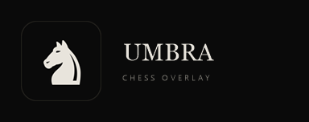

<p align="center">
  
</p>

<p align="center">
  <strong>Minimal chess analysis overlay with on-board arrows.</strong><br>
  Local engine, no accounts, nothing leaves your machine.
</p>

<p align="center">
  
  
  
  
</p>

---

## What it is

Umbra draws the engine's suggested move straight onto the chess.com board — one arrow for the move, plus a thin outline on the destination square that stays visible while your opponent is thinking.

Two parts:

| Part | What it does |
| --- | --- |
| **`umbra/`** — browser extension | Injects a local chess engine into the chess.com page and computes the move. |
| **`/overlay`** — Windows helper | Draws the arrow in a separate, capture-excluded window on top of the board. |

The browser **cannot** draw over another page by itself, which is why the arrow is rendered by the helper and not by the extension.

## Install

### 1. Extension

1. Open `about:debugging#/runtime/this-firefox` (Firefox) or `chrome://extensions` → **Developer mode** (Chrome/Edge).
2. **Load temporary add-on** / **Load unpacked** → pick the repository root (the folder containing `manifest.json`).
3. Pin it to the toolbar so the popup is one click away.

### 2. Helper

1. Double-click `overlay/start.vbs`. It launches without a console window.
2. An Umbra icon appears in the tray. **Left or right click** opens the menu:
   - **Restart**
   - **Quit**
   - Show / hide arrows
   - Status
   - Open log
3. Hotkeys: `Ctrl+Alt+H` toggle arrows, `Ctrl+Alt+Q` quit.

The helper listens on `127.0.0.1:8791` — loopback only, nothing is exposed to the network.

## Usage

1. Open a chess.com board (a game or the analysis board).
2. Open the popup and press **Scan board**.
3. The arrow appears on the board. The outlined square marks where the move lands.

Popup controls:

| Control | Effect |
| --- | --- |
| **Style** | Defensive / Neutral / Offensive — biases which moves the engine prefers. |
| **Engine strength** | Search depth and time budget. Higher is slower and heavier. |
| **Auto mode** | Starts the engine automatically for games inside an Elo range. |
| **Status** | Live connection state of the helper. |

## Troubleshooting

**The popup says `overlay off — run start.vbs`**
The helper is not running. Launch `overlay/start.vbs`, then press **Scan board** again.

**The arrow does not show up**
- The helper window is topmost but invisible; check that the tray icon is present (Windows hides new tray icons under **^** — pin it via Settings → Personalization → Taskbar → Other system tray icons).
- If you run with `CHESSBOT_ARROW_NO_EXCLUDE=1`, capture exclusion is skipped and the helper window becomes visible in screenshots.

**Helper already running**
A second instance refuses to start and tells you the tray icon is the way to control the first one. Use **Restart** in the menu instead of launching again.

**Log**
`%TEMP%\umbra-arrow.log`. Truncated automatically when it grows past 2 MB.

## Security and privacy

- The engine is local. **No cloud, no accounts, no telemetry** — the upstream analytics module and its remote endpoint were removed in this fork.
- The helper binds to `127.0.0.1` only. No port is reachable from the network.
- The extension requests `chess.com` access to read the board and `127.0.0.1:8791` to talk to the helper. Nothing else.

## Repository layout

```
umbra/                 <- repository root (load this folder in about:debugging)
  manifest.json        <- extension
  popup.html popup.js
  background.js          messaging, engine injection
  arrow-bridge.js        reads the board, sends geometry to the helper
  engine.js              engine loop + arrow geometry
  icon.png               logo (also used by the tray)
  assets/banner.png      README banner
  overlay/             <- Windows helper (PowerShell + C#)
    start.vbs            launcher (no console)
    arrow-helper.ps1     overlay window, tray, hotkeys
    ArrowServer.cs       loopback HTTP server on 8791
```

## Credits and license

Based on [bogenc/ChessBot](https://github.com/bogenc/ChessBot), which carries no license file, so no license is inherited. The modifications here — rebranding, tray-only control, single-arrow overlay, black outline hint, analytics removal — are released under **MIT**. See [LICENSE](LICENSE).

---

## По-русски

Umbra — минималистичный оверлей для chess.com: стрелка с подсказкой хода и тонкая рамка на клетке, куда фигура пойдёт (рамка видна, пока ходит соперник).

**Установка**

1. Расширение: `about:debugging#/runtime/this-firefox` → **Load temporary add-on** → выбрать папку с `manifest.json`.
2. Оверлей: запустить `overlay/start.vbs`. Появится иконка в трее.
3. **ЛКМ или ПКМ по иконке** — меню: «Перезапустить», «Выключить», «Скрыть/Показать стрелки», «Статус», «Открыть лог».
4. Хоткеи: `Ctrl+Alt+H` — скрыть/показать, `Ctrl+Alt+Q` — выход.

**Как пользоваться**

Открыть доску на chess.com → в поповере нажать **Scan board** → стрелка появится на доске.

**Если не работает**

- Поповер пишет `overlay off` — не запущен helper. Запустить `overlay/start.vbs` и нажать **Scan board** снова.
- Иконки нет в трее — Windows прячет новые значки под «^»: Параметры → Персонализация → Панель задач → Другие значки в области уведомлений → включить.
- Лог: `%TEMP%\umbra-arrow.log`.

**Приватность**

Движок работает локально. Ничего не отправляется в сеть: модуль аналитики с внешним сервером удалён. Helper слушает только `127.0.0.1:8791`.